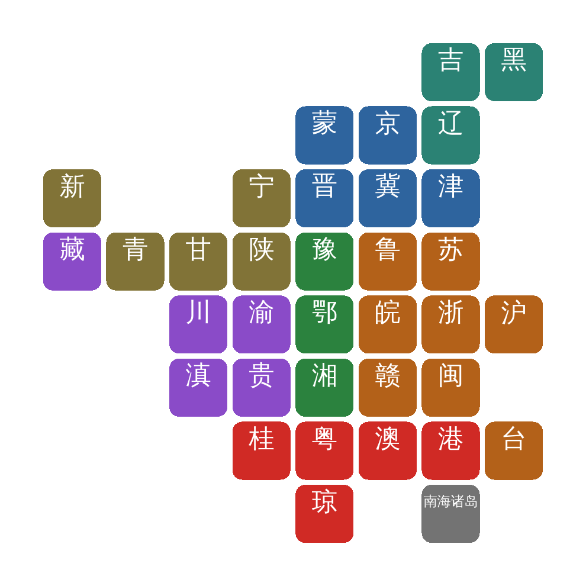

# pxCNmap

Pixel-art tile-grid (block) maps of China's province-level units — 方块地图 —
drawn with **base R graphics only**. No `ggplot2`, no `sf`, no `grid`; the
package needs nothing beyond `graphics` and `grDevices`, which ship with R.

Each of the 34 province-level units is drawn as a rounded square on a regular
grid. The layout is a minimum-displacement solution on a 480 km Albers grid,
so the tiles keep their geographic relationships (mean error 268 km, max
549 km against the true provincial centroids) while every unit gets the same
visual weight. That makes the maps well suited to rates, indices and
categorical groupings, and it lets values be printed straight onto the tiles.



## Installation

```r
# install.packages("remotes")
remotes::install_github("suyusung/pxCNmap")
```

## Usage

`colors` is either an unnamed vector of exactly 34 values, consumed in
`CN_TILE_ORDER`, or a named vector matched by short name (京) or full name
(北京市) in any order.

```r
library(pxCNmap)

## one colour per broad region, in CN_TILE_ORDER
region <- rep(c("#2E649E", "#2B8274", "#B36119", "#2B823E",
                "#D02A25", "#8A4BC8", "#817337"), length.out = 34)

tile_map_cn(region, label_colors = "white")

## write a figure straight to a file
tile_map_cn(region, file = "china_tile_map.png", width = 6.6, height = 6.6, res = 300)
```

Values can be printed under each name, and the tiles can carry an outline:

```r
fills <- setNames(region, CN_TILE_ORDER)
values <- round(seq(3, 28, length.out = 34), 1)

tile_map_cn(fills, numbers = values,
            border_color = "white", border_size = 1,
            nz_label_size = 12, number_size = 11)
```

Full administrative names also fit, since longer labels are shrunk
automatically:

```r
tile_map_cn(fills, name_type = "full", label_colors = "black",
            label_size = 4, corner_radius = 0, border_color = "grey20")
```

### English labels

For a figure that should not depend on a CJK font — a journal that does not
render the characters, or a machine without one installed — use
`name_type = "en"`. The labels are then the ISO 3166-2:CN two-letter codes
(`CN_TILE_EN`: `BJ`, `TJ`, `HE`, ...), and the 南海诸岛 inset is labelled
`"SCS"`:

```r
tile_map_cn(fills, name_type = "en", label_colors = "black",
            border_color = "grey20")

## the codes and the layout line up
data.frame(code = CN_TILE_EN, full = cn_tiles()$full[1:34])
```


### Useful arguments

| argument | purpose |
|---|---|
| `colors` | 34 fills, unnamed in `CN_TILE_ORDER` or named by province |
| `labels`, `name_type`, `label_size`, `label_colors` | the province names; `name_type` is `"short"` (京), `"full"` (北京市) or `"en"` (`BJ`) |
| `numbers`, `number_size`, `number_colors` | values printed under the names |
| `name_position` | `"top"` (leaves room for numbers) or `"auto"` |
| `border_color`, `border_size` | tile outlines (`NA` = none) |
| `corner_radius` | `0` for plain squares, higher for rounder ones |
| `nz_color`, `nz_label_size` | the 南海诸岛 inset tile |
| `family` | font family; set a CJK font if your device does not fall back |
| `file`, `width`, `height`, `res` | draw straight to a PNG |

`cn_tiles()` returns the layout itself (short name, full name, grid row and
column, and whether the row is the inset), and `CN_TILE_ORDER` gives the order
of the 34 units:

```r
cn_tiles()
CN_TILE_ORDER
```

## Note on CJK fonts

The labels are Chinese characters. Most devices find a CJK font automatically;
if yours does not, pass one explicitly, for example
`family = "WenQuanYi Zen Hei"` on Linux or `family = "SimHei"` on Windows.

## Repository layout

`attic/` holds an earlier `ggplot2`-based implementation of the same map. It
is not part of the package (it is listed in `.Rbuildignore`) and is kept only
for reference.

## License

GPL (>= 3).
